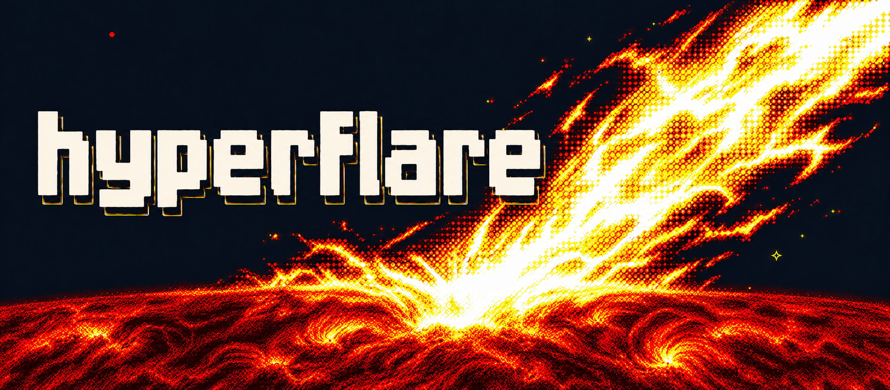

  

> **Coding agents:** skip this README and read [AGENTS.md](AGENTS.md) directly.

Hyperflare is a local inference server for NVIDIA SM120/SM121 GPUs, built for
long conversations, coding agents, and repeated tool use. Its goal is to make
the memory, bandwidth, and compute in workstations and compact systems such
as DGX Spark go further, while keeping generation responsive.

This is a research prototype, and is made available via open-source to enable
technical collaboration and collect early feedback.

The design rests on a few principles:

- **Embrace the standard PyTorch ecosystem at build time; serve from Rust.**
  Ignition uses PyTorch, Transformers, and FlashInfer/b12x to load models,
  tune kernels, compile forwards, and capture CUDA graphs into a runtime package.
  Helios, the Rust runtime, serves that package without Python. Compilation and
  graph capture finish before serving.

- **Build on the model ecosystem.** Reuse canonical model implementations
  wherever their dataflow fits, and specialize the parts that need different
  layouts or execution. Model development keeps the tools and libraries that
  make the Python ecosystem productive.

- **Make memory and state explicit.** Plan buffers and execution capacities
  ahead of time. Treat conversation state—including recurrent state alongside
  KV caches—as a whole, so reuse, branching, and resuming preserve it correctly.

- **Keep the runtime small and shared.** Model recipes own model computation;
  the runtime owns scheduling, cache storage, and request handling. A focused
  hardware and kernel stack keeps those boundaries manageable.

[vLLM](https://docs.vllm.ai/en/latest/) covers a much broader range of models,
hardware, and deployment patterns. Hyperflare trades that breadth for a focused
serving contract around selected models and local workloads. Hyperflare is not, and
will never be, a replacement for production inference engines like vLLM.

Think of Hyperflare as a specialized option when its hardware and model coverage
fit your machine.

Start with [model preparation and serving](docs/model-preparation.md).
See the [CLI guide](docs/cli-design.md) for configuration and the
[core design](docs/core-design.md) for the architectural reasoning.

## Licensing and contributions

Hyperflare's project code is licensed under [Apache 2.0](LICENSE). Contributions
require the sign-off described in [CONTRIBUTING.md](CONTRIBUTING.md).
Third-party attributions are listed in [NOTICE](NOTICE); upstream terms remain
applicable to third-party code and assets.

The PyTorch-derived image resizing implementation in `helios/` retains the
[PyTorch BSD-style license](helios/licenses/PyTorch.txt), also distributed with
[Heliopause](heliopause/licenses/PyTorch.txt). The DeepSeek recipe assets retain
their [MIT license](ignition/recipes/deepseek41/assets/LICENSE). The
`heliopause/LICENSE` and `heliopause/NOTICE` symlinks refer to the root files for
Python package distribution.

Upstream chat templates are fetched with the model checkpoints and annotated
locally using bundled insertion patches. Gemma uses pinned Google sources.
The custom Kimi segmented renderer is included as project code. Downloaded
model assets and exported model packages retain their upstream terms; see
[frontend preparation](docs/model-development.md#sampling-and-frontend-metadata).
